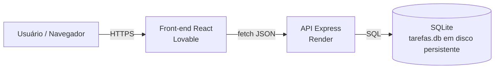
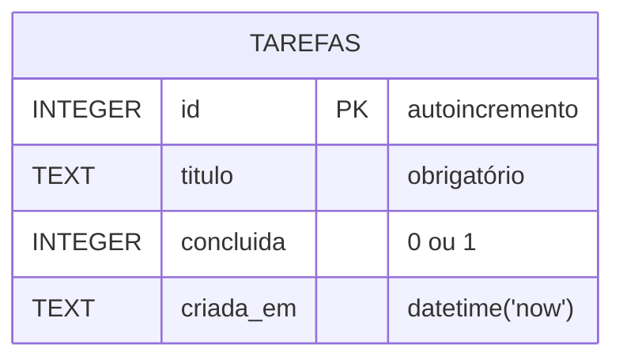
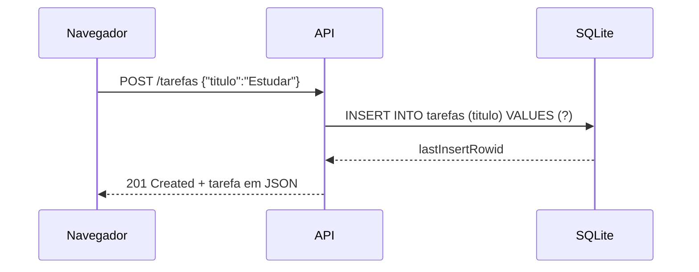

# Tarefas — API REST com SQLite

Aplicação web de lista de tarefas (CRUD) com:

- **Front-end**: React (TanStack Start) — pasta `src/`
- **API**: Node.js + Express — pasta `api/`
- **Banco**: SQLite (módulo nativo `node:sqlite`) — arquivo `tarefas.db`

## Arquitetura



## Modelo de dados



## Fluxo de criação de uma tarefa



## Endpoints

| Método | Rota | Descrição | Respostas |
|---|---|---|---|
| GET | `/` | Status da API | 200 |
| GET | `/tarefas` | Lista todas | 200 |
| GET | `/tarefas/:id` | Busca uma | 200, 404 |
| POST | `/tarefas` | Cria (`{ "titulo": "..." }`) | 201, 400 |
| PUT | `/tarefas/:id` | Atualiza (`titulo` e/ou `concluida`) | 200, 400, 404 |
| DELETE | `/tarefas/:id` | Remove | 204, 404 |

## Rodar localmente

```bash
cd api && npm install && npm start        # API em http://localhost:3000
# em outro terminal, na raiz:
bun install && bun run dev                 # front-end em http://localhost:8080
```

## Hospedagem (ponta a ponta)

1. **GitHub**: conecte o projeto ao GitHub (Lovable → Configurações → Git).
2. **API no Render**: New → Blueprint → escolha o repositório. O `render.yaml` cria o serviço com disco persistente em `/var/data` para o SQLite.
3. **Front-end**: defina `VITE_API_URL` com a URL do Render (ex.: `https://api-tarefas.onrender.com`) e publique.

## Variáveis de ambiente (API)

| Variável | Padrão | Uso |
|---|---|---|
| `PORT` | 3000 | Porta HTTP |
| `DB_PATH` | `./tarefas.db` | Caminho do arquivo SQLite |
| `CORS_ORIGIN` | `*` | Domínio permitido do front-end |
