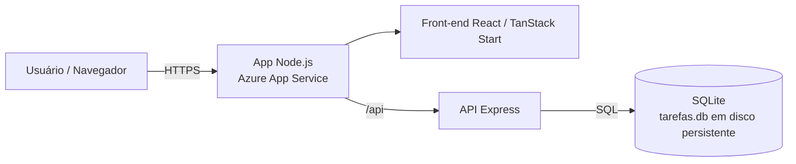
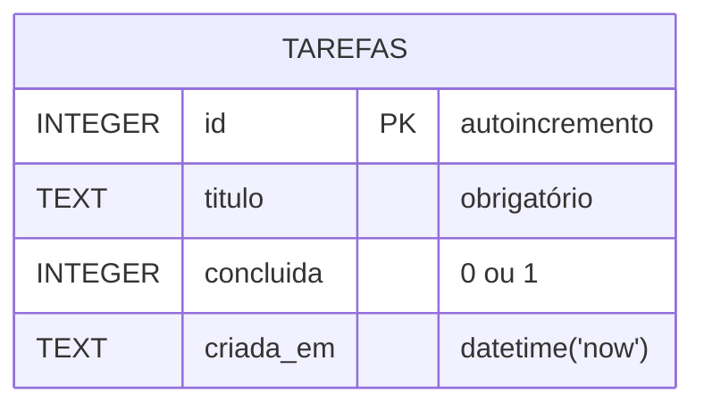

# GS - CLOUD SECURITY PREVENTION e DEVSECOPS

Aplicação web de lista de tarefas com:

- **Front-end**: React (TanStack Start) — pasta `src/`
- **API**: Node.js + Express — pasta `api/`
- **Banco**: SQLite (módulo nativo `node:sqlite`) — arquivo `tarefas.db`

## Arquitetura



## Modelo de dados



## Fluxo de criação de uma tarefa


## Endpoints

| Método | Rota | Descrição | Respostas |
|---|---|---|---|
| GET | `/api/` | Status da API | 200 |
| GET | `/api/tarefas` | Lista todas | 200 |
| GET | `/api/tarefas/:id` | Busca uma | 200, 404 |
| POST | `/api/tarefas` | Cria (`{ "titulo": "..." }`) | 201, 400 |
| PUT | `/api/tarefas/:id` | Atualiza (`titulo` e/ou `concluida`) | 200, 400, 404 |
| DELETE | `/api/tarefas/:id` | Remove | 204, 404 |

## Rodar localmente

```bash
cd api && npm install && npm start        # API em http://localhost:3000
# em outro terminal, na raiz:
bun install && bun run dev                 # front-end em http://localhost:8080
```

## Variáveis de ambiente (API)

| Variável | Padrão | Uso |
|---|---|---|
| `PORT` | 3000 | Porta HTTP |
| `DB_PATH` | `./tarefas.db` | Caminho do arquivo SQLite |
| `CORS_ORIGIN` | `*` | Domínio permitido quando a API é hospedada separadamente |

## Deploy no Azure App Service

O front-end e a API são servidos pelo mesmo processo Node.js e pelo mesmo App Service Linux (Node.js 24). A API Express fica sob `/api`; o preset Nitro `node-middleware` permite que o servidor Express encaminhe as demais requisições ao front-end TanStack Start.

O workflow `.github/workflows/deploy-app.yml` compila e testa o projeto, empacota o servidor e publica a aplicação em um único App Service:

1. Use um App Service **Linux** com Node.js 24. O App Service Windows existente não pode ser convertido; crie um Linux se necessário.
2. No GitHub, cadastre a Action variable `APP_NAME` com o nome exato do App Service.
3. Baixe o publish profile desse App Service e cadastre-o como o Action secret `APP_PUBLISH_PROFILE`. Não inclua esse XML no repositório.
4. Configure `DB_PATH` como `/home/tarefas.db` nas variáveis do App Service e habilite o armazenamento persistente para `/home`.
5. Configure o Startup Command como `npm start`.
6. Envie as alterações para `main` ou execute **Deploy app to Azure** em **GitHub → Actions**.

O workflow define `VITE_API_URL=/api` durante o build, então não é necessária uma URL separada para a API nem configuração de CORS entre serviços.

Para desenvolvimento local, inicie a API em um terminal (`cd api; npm install; npm start`) e o front-end em outro (`npm run dev` na raiz). O `render.yaml` continua disponível para hospedar apenas a API no Render.
