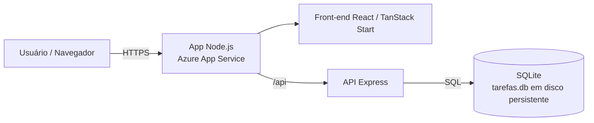
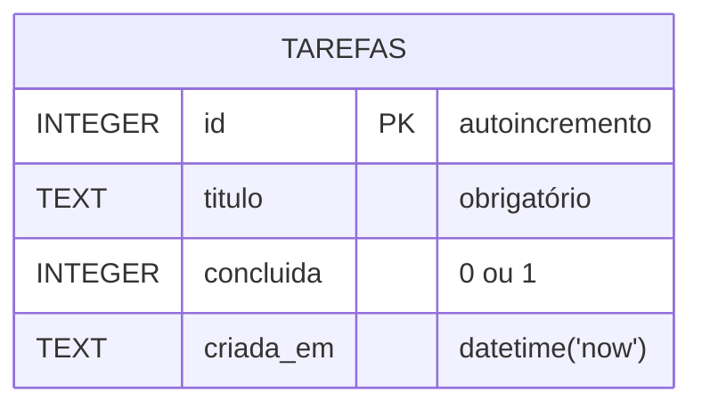

# GS - CLOUD SECURITY PREVENTION e DEVSECOPS

Aplicação web de lista de tarefas com:

- **Front-end**: React (TanStack Start) — pasta `src/`
- **API**: Node.js + Express — pasta `api/`
- **Banco**: SQLite (módulo nativo `node:sqlite`) — arquivo `tarefas.db`

## Arquitetura



## Modelo de dados



## Fluxo de criação de uma tarefa


## Rodar localmente

```bash
cd api && npm install && npm start        # API em http://localhost:3000
# em outro terminal, na raiz:
bun install && bun run dev                 # front-end em http://localhost:8080
```

## Variáveis de ambiente (API)

| Variável | Padrão | Uso |
|---|---|---|
| `PORT` | 3000 | Porta HTTP |
| `DB_PATH` | `./tarefas.db` | Caminho do arquivo SQLite |
| `CORS_ORIGIN` | `*` | Domínio permitido quando a API é hospedada separadamente |

## Deploy no Azure App Service

O front-end e a API são servidos pelo mesmo processo Node.js e pelo mesmo App Service Linux (Node.js 24). A API Express fica sob `/api`; o preset Nitro `node-middleware` permite que o servidor Express encaminhe as demais requisições ao front-end TanStack Start.

### Resumo do passo a passo

1. No Portal Azure, crie um recurso **Web App** com publicação por código, sistema operacional **Linux**, runtime **Node.js 24**, região desejada e um plano compatível com o orçamento (o plano B1 é pago). Aguarde a criação e anote o nome exato do App Service.
2. No App Service, configure o comando de inicialização `npm start` e a variável `DB_PATH=/home/tarefas.db`. Habilite e confirme o armazenamento persistente em `/home`; o SQLite desta arquitetura é adequado para uma única instância.
3. No GitHub, em **Settings → Secrets and variables → Actions**, crie a variável `APP_NAME` com o nome exato do App Service e o secret `APP_PUBLISH_PROFILE` com o perfil de publicação baixado desse mesmo recurso. Nunca adicione o XML ao repositório, ao README ou a capturas.
4. Antes de publicar, confira os workflows em `.github/workflows`: `deploy-app.yml` usa `APP_NAME` e `APP_PUBLISH_PROFILE`, enquanto `main_wa-gs-cloudsec.yml` contém outro destino e autenticação. Ajuste ou desative o workflow que não será usado para evitar deploy no aplicativo errado.
5. Na aba **Actions** do GitHub, execute **Deploy app to Azure** na branch `main`, ou envie para `main` uma alteração coberta pelos caminhos configurados no workflow. O pipeline instala as dependências, compila o front-end, executa os testes e publica o pacote.
6. Após o deploy, confirme a execução do workflow, acesse a aplicação por HTTPS e verifique a interface e as rotas `GET /api/` e `GET /api/tarefas`. Teste as operações de tarefas e, após reiniciar o serviço, confirme que os dados persistem.

O workflow `.github/workflows/deploy-app.yml` automatiza o build, os testes, o empacotamento e a publicação. Ele define `VITE_API_URL=/api` durante o build; como o front-end e a API compartilham o mesmo domínio, não é necessária uma URL separada para a API nem configuração de CORS entre serviços.

Para desenvolvimento local, inicie a API em um terminal (`cd api; npm install; npm start`) e o front-end em outro (`npm run dev` na raiz). O `render.yaml` continua disponível para hospedar apenas a API no Render.
