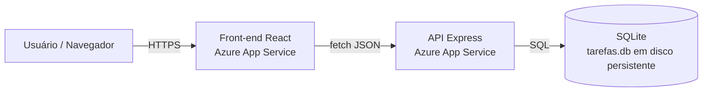
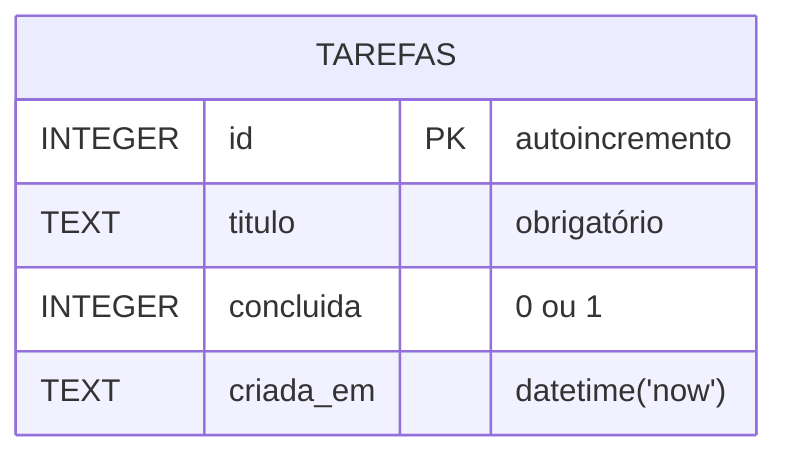
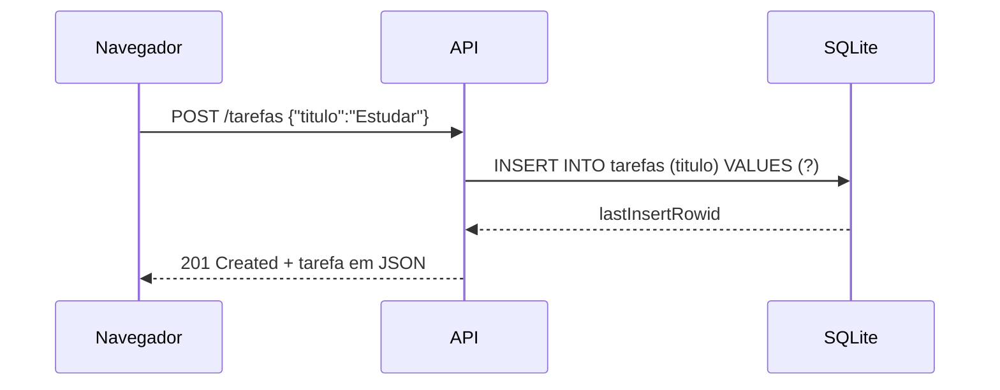

# GS - CLOUD SECURITY PREVENTION e DEVSECOPS

Aplicação web de lista de tarefas com:

- **Front-end**: React (TanStack Start) — pasta `src/`
- **API**: Node.js + Express — pasta `api/`
- **Banco**: SQLite (módulo nativo `node:sqlite`) — arquivo `tarefas.db`

## Arquitetura



## Modelo de dados



## Fluxo de criação de uma tarefa



## Endpoints

| Método | Rota | Descrição | Respostas |
|---|---|---|---|
| GET | `/` | Status da API | 200 |
| GET | `/tarefas` | Lista todas | 200 |
| GET | `/tarefas/:id` | Busca uma | 200, 404 |
| POST | `/tarefas` | Cria (`{ "titulo": "..." }`) | 201, 400 |
| PUT | `/tarefas/:id` | Atualiza (`titulo` e/ou `concluida`) | 200, 400, 404 |
| DELETE | `/tarefas/:id` | Remove | 204, 404 |

## Rodar localmente

```bash
cd api && npm install && npm start        # API em http://localhost:3000
# em outro terminal, na raiz:
bun install && bun run dev                 # front-end em http://localhost:8080
```

## Variáveis de ambiente (API)

| Variável | Padrão | Uso |
|---|---|---|
| `PORT` | 3000 | Porta HTTP |
| `DB_PATH` | `./tarefas.db` | Caminho do arquivo SQLite |
| `CORS_ORIGIN` | `*` | Domínio permitido do front-end |

## Deploy no Azure App Service

Para hospedar a aplicação no Azure, publique o front-end e a API em **dois App Services Linux separados**, ambos com Node.js 24. O front-end usa o preset Nitro `node-server`; `npm run build` gera o servidor e `npm start` o inicia.

Os workflows do GitHub Actions em `.github/workflows/` fazem build e deploy dos serviços separadamente:

1. Crie um App Service Linux para o front-end e outro para a API, usando Node.js 24.
2. No GitHub, cadastre estas **Actions variables**:
   - `FRONTEND_APP_NAME`: nome do App Service do front-end.
   - `API_APP_NAME`: nome do App Service da API.
   - `VITE_API_URL`: URL pública da API, sem barra final (por exemplo, `https://minha-api.azurewebsites.net`).
3. Baixe o publish profile de cada App Service e cadastre como **Actions secrets**:
   - `FRONTEND_PUBLISH_PROFILE`
   - `API_PUBLISH_PROFILE`
4. Configure no App Service da API:
   - `CORS_ORIGIN`: origem pública do front-end (por exemplo, `https://meu-front.azurewebsites.net`).
   - `DB_PATH`: `/home/tarefas.db`.
   - Armazenamento persistente habilitado para `/home`.
5. Configure o App Service do front-end para iniciar com `npm start` (ou deixe o detector de Node do App Service usar o script `start`).
6. Envie as alterações para a branch `main`. Cada workflow publica somente o serviço correspondente. Também é possível iniciá-los manualmente em **GitHub → Actions**.

Os workflows precisam dos nomes e secrets acima antes de executar; não inclua publish profiles ou outras credenciais no repositório. O App Service Windows atual não pode ser convertido em Linux: para seguir esta configuração, crie novos App Services Linux.
